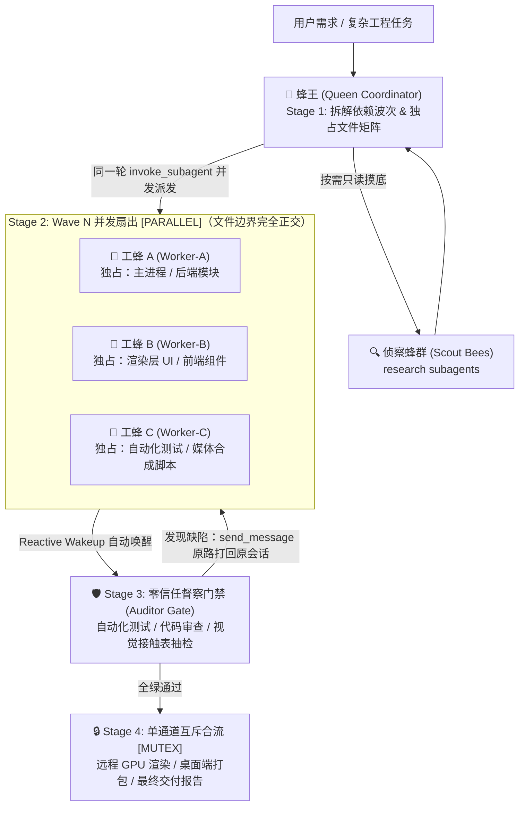

# lingnian-skills

精选 AI Agent 实战技能库（**Agent Skills Collection**），遵循标准 `SKILL.md` 规范，支持 **Google Antigravity (AGY)**、**Claude Code**、**Hermes Agent**、**Cursor** 等主流智能体编码与自动化环境开箱即用。

---

## 📦 已收录技能目录 (Available Skills)

| 技能目录 | 名称 | 核心定位 | 适用场景 |
| :--- | :--- | :--- | :--- |
| **[`./hive-swarm`](./hive-swarm)** | **Hive-Swarm（蜂巢多智能体协同）** | **蜂王统筹 + 依赖波次并发 + 单通道资源互斥锁 + 零信任督察返工** | 多模块全栈 App 开发、跨文件并发重构、多阶段音视频/数据渲染流水线 |

*(更多自研实战技能将持续按独立文件夹追加至本仓库)*

---

## 🐝 核心技能详解：`hive-swarm`（蜂巢多智能体协同模式）

### 1. 为什么要做 `hive-swarm`？（解决传统多 Agent 两大痛点）

在实际工程中使用多智能体（Multi-Agent Swarm）时，常见方案往往陷入两个极端：
1. **无主控盲目并发（Masterless Race Condition）**：多个子 Agent 同时读写同一批文件，或者同时抢占单通道资源（如同一个远程 GPU WebSocket 会话、同一个打包锁文件），导致文件互相覆盖或连接雪崩。
2. **过度官僚化的串行审批（Bureaucratic Sequential Loop）**：每推进一个小功能都要串行派生十几个“调研 Agent → 计划评审 Agent → 挑战者 Agent”，导致 **90% 的 Token 和时间花在写 Markdown 报告开会上，真正写代码的 Worker 却在排队单线程串行执行**。

**`hive-swarm` 的解法**：
砍掉冗余的文书传递，由主会话担任 **蜂王（Queen Coordinator）**，直接按 **物理文件归属权（File Ownership）** 将无冲突的编码任务划分为并发波次（`[PARALLEL]`），同时对不可并发抢占的瓶颈资源加装单通道互斥锁（`[MUTEX:<resource>]`），并在合流前执行严格的 **零信任督察与原位返工（Stateful Rework）**。

---

### 2. 架构与工作流图解 (Architecture)



---

### 3. 实战提速对比 (Real-World Benchmark)

以一个真实的 **跨平台离线桌面端收银系统（Electron + 本地持久化 + 80mm 热敏打印 + 端到端冒烟测试）** 开发任务为例：

| 对比维度 | 传统重量级串行团队模式 | `hive-swarm` 蜂巢波次并发模式 |
| :--- | :--- | :--- |
| **子 Agent 派生结构** | 每个里程碑串行跑完 `3 调研 + 2 评审 + 1 编码 + 1 审计 + 2 红队`，累计派生 **33 个子 Agent**（其中 30 个仅产出报告） | 直接按正交文件边界（`main.js`/`preload.js` vs. `app/index.html` vs. `test/smoke-test.js`）同波次派出 **3 只纯编码工蜂** |
| **冲突与资源控制** | 多轮重复扫描全仓，反复重跑完整打包 | 工蜂只写各自白名单文件；打包与硬件调用归入 `[MUTEX]` 由蜂王统一串行执行 |
| **返工机制** | 发现 4 行离线泄漏需重新开启新一轮多 Agent 调研循环 | 督察发现问题直接通过 `send_message` 打回原工蜂 `conversationId` 秒级秒修 |
| **端到端总耗时** | **2.5 ~ 4.5 小时** | **约 10 ~ 15 分钟** |

---

## 🚀 安装与部署说明 (Installation)

### 方式一：安装到 Google Antigravity 全局技能目录（推荐）

将 `hive-swarm` 文件夹复制到本机全局技能目录，所有工作区即可自动识别并热加载：

#### Windows (PowerShell)
```powershell
git clone https://github.com/lingnianjing-lab/lingnian-skills.git
Copy-Item -Recurse -Force .\lingnian-skills\hive-swarm "$HOME\.gemini\config\skills\hive-swarm"
```

#### macOS / Linux (Bash / Zsh)
```bash
git clone https://github.com/lingnianjing-lab/lingnian-skills.git
mkdir -p ~/.gemini/config/skills
cp -r ./lingnian-skills/hive-swarm ~/.gemini/config/skills/hive-swarm
```

### 方式二：安装到单个项目的本地工作区（团队共享）

如果你希望将该技能随项目 Git 仓库共享给团队成员，可将其放入项目根目录的 `.agents/skills/` 下：

```bash
mkdir -p .agents/skills
cp -r ./lingnian-skills/hive-swarm .agents/skills/hive-swarm
```

### 方式三：在 Claude Code / Hermes Agent / 其他兼容环境中使用

```bash
mkdir -p ~/.claude/skills
cp -r ./lingnian-skills/hive-swarm ~/.claude/skills/hive-swarm
```

---

## 💡 触发与使用指南 (How to Use)

### 1. 触发词 (Trigger Phrases)
安装完成后无需重启会话，直接在对话框中使用以下任意自然语言指令即可激活：
- **“启动蜂巢模式，帮我把这几个模块并行做完”**
- **“用 `hive-swarm` 架构拆解并执行这个项目”**
- **“蜂群协作开发：前端、后端和测试同时推进，你当审核员来监督”**

### 2. 四步标准执行体验 (What Happens After Triggering)
1. **看表确认（Stage 1）**：主 Agent（蜂王）会先向你输出一张 **「蜂巢波次作战表（Wave Plan）」**，列明每只工蜂负责的独占文件白名单（Allowed Files）、哪些步骤是 `[PARALLEL]` 并发、哪些步骤是 `[MUTEX]` 串行锁。
2. **后台并发（Stage 2）**：蜂王在同一轮调用中同时放出所有当前波次的工蜂并行编码，利用系统原生 **响应式唤醒（Reactive Wakeup）** 等待工蜂完工，不写死循环轮询。
3. **督察把关（Stage 3）**：工蜂交活后，蜂王不会直接采信口头报告，而是运行真实测试脚本、调用 `code-reviewer` 或生成压缩预览接触表（Contact Sheet）亲自做视觉抽检（例如排查图表文字贴边、AI 图像几何幻觉、音频削波等）。一旦发现瑕疵，立刻通过 `send_message` 原路打回原工蜂返工。
4. **合流交付（Stage 4）**：所有门禁全绿后，蜂王执行最终合流打包，并输出包含实测数据与客观证据的交付报告。

### 3. 目录结构说明
```text
lingnian-skills/
├── README.md                                 # 仓库总览与使用文档
├── LICENSE                                   # MIT 开源许可证
└── hive-swarm/                               # 蜂巢多智能体协同技能包
    ├── SKILL.md                              # 核心编排指令（四层拓扑 + 四阶段 SOP）
    └── references/
        └── dispatch-templates.md             # 渐进式披露：波次表、派单契约与原位返工模板
```

---

## 🙏 架构致谢 (Acknowledgments)

`hive-swarm` 的全部指令文本、互斥锁机制与原生工具映射均为原创编写，部分多智能体工程设计思想参考并融合了以下优秀开源项目的架构理念，特此致谢：
- **[`ruvnet/ruflo`](https://github.com/ruvnet/ruflo)** (MIT License) — 借鉴其 Queen-Led（女王蜂统筹与专职工蜂角色分层）的层级协调思想；
- **[`rllm-org/hive`](https://github.com/rllm-org/hive)** (Apache-2.0 License) — 借鉴其以量化实验指标驱动迭代闭环（Experiment & Audit Loop）的理念；
- **[`am-will/swarms`](https://github.com/am-will/swarms)** — 借鉴其显式依赖波次（Dependency Waves）与防止多代理文件冲突的规划思路。

---

## 📄 开源协议 (License)

本项目采用 [MIT License](./LICENSE) 开源协议，欢迎自由 Star、Fork、修改与集成。
